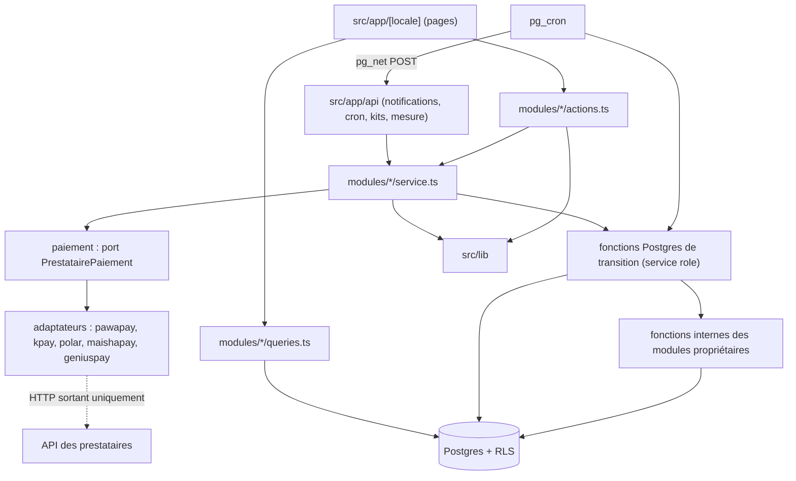
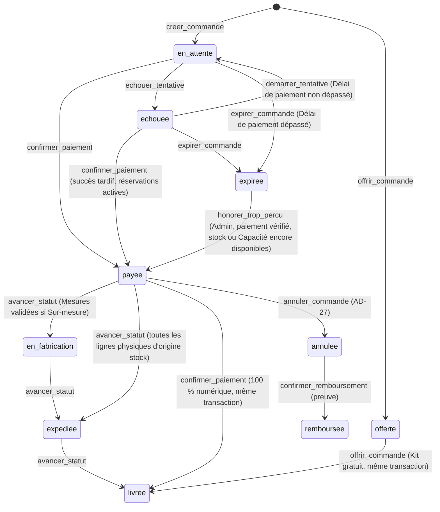
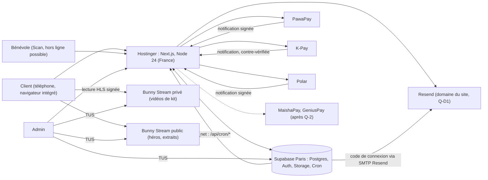
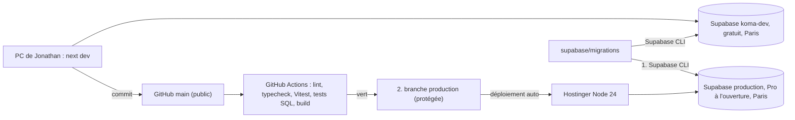
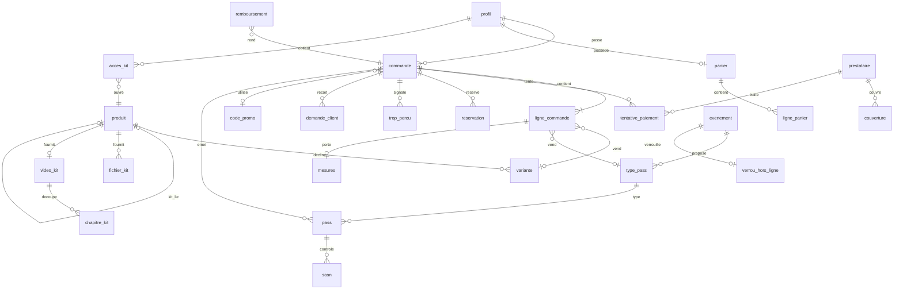

# Architecture Spine — KOMA SHOP

Les termes en majuscule (Commande, Pass, Tentative de paiement…) sont ceux du Glossaire du PRD (§3). `CLAUDE.md` (règles 1 à 15) prime sur ce document.

## Design Paradigm

**Monolithe modulaire** : une seule application Next.js (App Router), déployée comme un serveur Node unique. Le code métier vit dans des **modules de domaine** côté serveur ; chaque prestataire de paiement est branché par un **adaptateur** derrière un port commun ; les changements d'état qui doivent être atomiques sont des **fonctions Postgres**.

| Couche | Emplacement | Rôle |
| --- | --- | --- |
| Présentation | `src/app/[locale]/…` | Pages et layouts (Server Components par défaut), composants client seulement pour l'interaction |
| Entrées techniques | `src/app/api/…` | Notifications des prestataires, routes de tâches planifiées, liens et jetons signés, mesure |
| Domaine | `src/modules/<module>/` | `actions.ts` (Server Actions), `service.ts`, `queries.ts`, `schemas.ts`, `types.ts` ; tout fichier importe `server-only` sauf `types.ts` et `schemas.ts` |
| Adaptateurs | `src/modules/paiement/adaptateurs/<prestataire>/` | Traduction entre l'API d'un prestataire et le port commun |
| Noyau transactionnel | `supabase/migrations/` | Tables, RLS, fonctions de transition et fonctions internes des modules, tâches pg_cron |
| Transverse | `src/lib/` | Clients Supabase, auteur, droits, cache, i18n, argent, dates, SEO, journal |



Sens des dépendances : présentation → domaine → (port, fonctions Postgres, lib). Un adaptateur ne dépend que du port et de `src/lib` ; il n'importe aucun module et n'écrit jamais en base.

## Invariants & Rules

### AD-1 — Modules propriétaires de leurs tables [ADOPTED]

- **Binds:** all
- **Prevents:** deux stories qui écrivent la même table avec des règles différentes ; une story qui réécrit la fonction de transition d'un autre module et efface ses effets.
- **Rule:** chaque table appartient à un seul module (tableau « Modules et tables »). En TypeScript, seul ce module l'écrit ; un autre module passe par les fonctions exportées de `service.ts` ou `queries.ts` du propriétaire. En SQL, une fonction de transition qui doit produire un effet dans la table d'un autre module appelle une **fonction interne** de ce module, nommée `<module>_<verbe>` (ex. `bibliotheque_ouvrir_acces`, `evenements_emettre_pass`, `catalogue_decrementer_stock`, `envois_planifier`, `admin_signaler_anomalie`) ; une story ajoute ou modifie un effet en changeant **la fonction interne de son module**, jamais la fonction de transition d'un autre. Aucun trigger métier entre modules. Une migration qui fait `CREATE OR REPLACE` d'une fonction existante part de sa dernière version appliquée, et les tests de toutes les stories livrées repassent.

### AD-2 — Le navigateur n'écrit jamais dans une table métier [ADOPTED]

- **Binds:** all ; CLAUDE.md règles 1-3 ; NFR-4, NFR-5
- **Prevents:** un prix, un stock, un statut ou un droit modifié depuis le client ; la clé service role exposée.
- **Rule:** toute écriture passe par une Server Action ou une route `src/app/api`, qui valide l'entrée (Zod), construit l'auteur (AD-25) puis appelle le module. La RLS est active sur **toutes** les tables, et aucune politique n'autorise d'INSERT/UPDATE/DELETE au rôle `authenticated` ou `anon` sur une table métier. Trois clients Supabase, et seulement eux : `src/lib/supabase/public.ts` (rôle `anon`, sans cookie, pour les lectures publiques mises en cache), `src/lib/supabase/session.ts` (session de l'utilisateur, pour ses propres données), `src/lib/supabase/service.ts` (service role, `server-only`, pour appeler les fonctions d'écriture). Seules dérogations côté navigateur : (a) les téléversements directs vers le stockage sur autorisation signée par le serveur (AD-18) ; (b) la file de scans hors ligne en IndexedDB (AD-12).

### AD-3 — Les états changent uniquement par des fonctions Postgres de transition [ADOPTED]

- **Binds:** FR-13, FR-19, FR-23..FR-26, FR-34..FR-38, FR-42, FR-58 ; NFR-5, NFR-9
- **Prevents:** un `UPDATE … SET statut` écrit à la main ; deux validations concurrentes ; une transition interdite ; un navigateur qui appelle `confirmer_paiement` par RPC.
- **Rule:** les colonnes de statut (Commande, Tentative, Pass, Envoi, Demande client, Remboursement) et les compteurs de stock sont modifiés uniquement par des fonctions Postgres `SECURITY DEFINER` avec `SET search_path = ''`. Chacune verrouille la ligne (`SELECT … FOR UPDATE`), refuse toute transition absente de la matrice, applique tous ses effets dans la même transaction et journalise (AD-21). **Droits d'exécution :** chaque fonction qui écrit est créée avec `REVOKE EXECUTE … FROM PUBLIC, anon, authenticated` et `GRANT EXECUTE … TO service_role` dans la même migration ; seules les fonctions de lecture pure (`a_le_role`, `est_mineur`, `stock_disponible`, `places_fabrication_utilisees`, `places_evenement_utilisees`) restent exécutables par `authenticated` et `anon`. Un test CI liste les fonctions exécutables par `anon` ou `authenticated` et échoue si l'une d'elles écrit. Fonctions de transition : `creer_commande`, `demarrer_tentative`, `confirmer_paiement`, `echouer_tentative`, `abandonner_tentative`, `expirer_commande`, `offrir_commande`, `avancer_statut`, `corriger_mesures`, `valider_mesures`, `annuler_commande`, `confirmer_remboursement`, `annuler_pass`, `scanner_pass`, `prendre_verrou`, `synchroniser_scans`, `liberer_verrou`, `traiter_demande`, `attribuer_pass_offert`, `honorer_trop_percu`. D'autres fonctions d'écriture sont permises si elles suivent les mêmes droits. Aucun statut ne recule.



Une Commande `produits` 100 % numérique passe `payee` puis `livree` dans la transaction de `confirmer_paiement` (deux lignes de journal) ; une Commande `offerte` de Kit passe `livree` dans celle d'`offrir_commande`. Une Commande `pass` ne quitte jamais `payee` ou `offerte` ; chaque Pass suit `valide` → `scanne` ou `valide` → `annule` → `rembourse`. Côté client, une Commande `expediee` en retrait à Goma s'affiche « Prête à retirer » (affichage seulement, aucun statut).

### AD-4 — `confirmer_paiement` est la seule porte vers `payee` [ADOPTED]

- **Binds:** FR-17, FR-19, FR-20, FR-47 ; CLAUDE.md règle 2 ; NFR-5
- **Prevents:** double validation ; faux Trop-perçu sur une notification rejouée ; validation d'un montant partiel ; une erreur d'unicité qui annule un paiement encaissé.
- **Rule:** `tentative_paiement` porte `reference_interne` (générée par nous, envoyée au Prestataire, `UNIQUE`) et `reference_transaction` (renvoyée par le Prestataire, `UNIQUE (prestataire, reference_transaction)`). `confirmer_paiement(p_auteur, tentative, montant_recu, devise_recue, preuve)` verrouille la Tentative puis la Commande :
  0. Tentative déjà `reussie` ou `echouee` → aucun effet, retour « déjà traité » (rejeu).
  1. Succès vérifié et montant reçu **égal** au montant attendu (règle de comparaison de l'adaptateur, AD-8), Commande `en_attente` ou `echouee` avec réservations actives → Tentative `reussie`, Commande `payee`, `paye_le` posé, et dans la même transaction, par les fonctions internes (AD-1) : décompte du stock des lignes d'origine `stock`, `acces_kit` (AD-11), Pass émis (AD-12), envois planifiés (AD-9). Une Commande dont les réservations sont actives est honorable par construction : stock, Plafond, Capacité et Code promo ne sont pas revérifiés (AD-26, AD-29).
  2. Montant reçu **inférieur** → Tentative `reussie`, Commande inchangée, `anomalie` `montant_insuffisant` avec le montant reçu.
  3. Montant **supérieur**, ou Commande déjà `payee`, `expiree`, `annulee`, ou réservations libérées et plus honorables → Tentative `reussie`, `trop_percu` créé, Commande inchangée.

  Aucun remboursement automatique. Une Commande `offerte` (0 USD, sans Prestataire) n'est jamais `payee`, n'a jamais de `paye_le` et ne compte jamais comme premier achat. `confirmer_paiement` n'est appelée qu'après une confirmation fiable obtenue par le serveur (CLAUDE.md règle 2) : notification à signature vérifiée, ou contre-vérification du statut auprès de l'API du Prestataire ; elle est appelée par la route de notification du Prestataire ou par la tâche `reconcilier-tentatives`. `honorer_trop_percu(p_auteur, trop_percu)` (Admin seulement) permet d'honorer à la main une Commande `expiree` dont le paiement est arrivé après l'expiration : Trop-perçu de motif `expiree`, montant reçu égal au montant attendu, stock, Plafond et Capacité revérifiés par les fonctions d'AD-26 et AD-12 ; elle applique alors les mêmes effets que `confirmer_paiement` et clôt le Trop-perçu (statut `honore`).

### AD-5 — Port de paiement, routes de notification et repli [ADOPTED]

- **Binds:** FR-15..FR-17, FR-19, FR-21 ; CLAUDE.md règles 2, 9, 13
- **Prevents:** un adaptateur qui écrit en base ; un délai dépassé traité comme un échec ; une tempête de rejeux ; un repli décidé dans le dos du client.
- **Rule:** chaque adaptateur implémente `PrestatairePaiement` : `initier(tentative)`, `verifierNotification(requete)`, `consulterStatut(reference)`, `comparerMontant(attendu, recu, devise)`. Il renvoie un résultat normalisé `succes | echec_client | echec_prestataire | inconnu` avec montant et devise reçus et n'a aucun accès à Supabase. Vérification : PawaPay par signature RFC 9421 (rappels signés activés dans son tableau de bord), Polar par Standard Webhooks, K-Pay **uniquement** par contre-vérification `consulterStatut` : sa notification n'est qu'un signal, l'interrogation de son API fait foi. Les adaptateurs K-Pay et MaishaPay sont construits à partir de la documentation officielle de K-Pay et de MaishaPay, fournie par Jonathan dans `docs/references/paiements/` (hors dépôt) ; couverture pays-opérateur (Q-1) et contrôle du montant reçu (Q-3) tirés de cette documentation (appels, devises, vérification des notifications), sans rien deviner. Une route par prestataire, `POST /api/paiement/notification/[prestataire]` : vérifie (401 si la vérification échoue), enregistre la notification dans `notification_recue` (`UNIQUE (prestataire, id_notification)`), appelle le service, puis répond **200** même si la transition est refusée (le refus devient une `anomalie` `transition_refusee`). Repli : seulement sur `echec_prestataire` confirmé ou Agrégateur désactivé, jamais sur `echec_client` ni `inconnu`, et toujours proposé au client (« Réessayer avec … »), qui déclenche lui-même la nouvelle Tentative. Adaptateurs au lancement : PawaPay (API v2), K-Pay (mobile money et carte), MaishaPay (mobile money), Polar ; GeniusPay après Q-2. MaishaPay carte reste un secours non branché tant que Jonathan ne l'a pas confirmé.

### AD-6 — Un seul aiguilleur de prestataire [ADOPTED]

- **Binds:** FR-16, FR-18 ; CLAUDE.md règles 10, 11
- **Prevents:** un Panier mixte ou un Pass qui part chez Polar ; une règle de choix recopiée dans plusieurs écrans ; un repli vers un Agrégateur déjà en échec.
- **Rule:** `choisirPrestataire(achat, moyen, pays, operateur, prestatairesActifs, couverture, ordre, exclus)` dans `src/modules/paiement/aiguillage.ts` est une fonction pure, seule source du choix ; `exclus` = Agrégateurs dont une Tentative de cette Commande a fini en `echec_prestataire`. Le service lui passe les Familles **lues en base**. Matrice : carte + Pass → K-Pay ; carte + au moins un Produit physique → K-Pay ; carte + Panier 100 % numérique → Polar, sinon « Carte indisponible » ; mobile money → premier Agrégateur actif non exclu de l'Ordre de priorité qui couvre le couple pays-opérateur, sinon aucun. Tests obligatoires (Vitest pour l'aiguillage, tests SQL pour les fonctions) : Panier mixte jamais Polar ; Pass jamais Polar ; repli vers l'Agrégateur suivant du même couple ; référence déjà utilisée refusée ; délai dépassé sans repli ; notification tardive après expiration ; deux Tentatives réussies sur deux Agrégateurs ; notification rejouée sans effet ; montant insuffisant non validé ; Kit déjà possédé sans annulation du paiement.

### AD-7 — Un achat de Pass est une Commande de type `pass` [ADOPTED]

- **Binds:** FR-11, FR-33, FR-34, FR-42, FR-47
- **Prevents:** un second circuit de paiement pour les Pass ; un Pass représenté par une fausse variante de catalogue ; des noms de titulaires stockés de deux façons.
- **Rule:** `commande.type` ∈ {`produits`, `pass`}. Une Commande `pass` ne naît jamais d'un Panier et utilise la même couche de paiement, les mêmes statuts et le même Code promo. `ligne_commande` porte exactement un de `variante_id` ou `type_pass_id` (`CHECK`). Une ligne de Pass = un Type de pass × une quantité ; un Stand produit **2 Pass par unité** (titulaire et aide). Les noms des titulaires sont saisis à l'achat et figés dans `ligne_commande.titulaires` (tableau, longueur = nombre de Pass) ; le nom de l'acheteur y est copié depuis son profil.

### AD-8 — Argent en centimes USD, valeurs figées à la commande [ADOPTED]

- **Binds:** FR-13, FR-14, FR-19, FR-38, FR-47, FR-48 ; CLAUDE.md règles 2, 3
- **Prevents:** erreurs d'arrondi ; un montant recalculé avec un prix, un taux ou un délai modifié après la commande ; deux Commandes créées par un double clic.
- **Rule:** tout montant est un entier en centimes (`*_cents`) avec un code devise ISO 4217 ; jamais de nombre à virgule. `creer_commande` lit en base et **fige** : prix de chaque ligne, `reduction_cents` de chaque ligne (réduction totale × prix de la ligne / sous-total, arrondie au centime inférieur, reste sur la dernière ligne), sous-total, Forfait de livraison, total, taux de commission du Code promo, pourcentage de frais d'annulation des Pass, délai total annoncé par ligne physique, échéance de paiement (`expire_le`). La réduction ne porte jamais sur le Forfait. `tentative_paiement` enregistre `montant_attendu_cents` (USD), `montant_recu` et `devise_recue` tels que renvoyés. La comparaison montant reçu / attendu est codée dans `comparerMontant` de chaque adaptateur, d'après la documentation du Prestataire (Q-3) ; aucune tolérance n'est inventée. `creer_commande` et `demarrer_tentative` reçoivent une `cle_idempotence` générée par le formulaire : une même clé renvoie la même Commande ou Tentative.

### AD-9 — Les effets externes passent par la boîte d'envoi [ADOPTED]

- **Binds:** FR-32, FR-44, FR-45, FR-59 ; CLAUDE.md règle 13
- **Prevents:** un email perdu ; un email marqué envoyé sans réponse du service ; des modèles nommés différemment par chaque story ; un email commercial écarté traité comme une panne.
- **Rule:** une fonction de transition planifie un email par `envois_planifier` dans sa transaction. `envoi.modele` est une énumération Postgres fermée, étendue seulement par migration : `commande_payee`, `commande_en_fabrication`, `commande_expediee`, `commande_livree`, `commande_annulee`, `commande_remboursee`, `kit_ouvert`, `pass_emis`, `pass_annule`, `pass_rembourse`, `galerie_evenement`, `relance`, `panier_abandonne`, `rappel_kit`, `nouveau_produit`, `alerte_evenement`. `envoi.donnees` ne contient que des identifiants ; le rendu relit la base au moment de l'envoi. `envoi.langue` est figée à l'insertion depuis `profil.langue` (`fr` par défaut). `envoi.statut` ∈ {`a_envoyer`, `envoye`, `echec`, `abandonne`, `ignore`} : seule la route `/api/cron/envois` envoie via Resend et ne pose `envoye` qu'avec l'identifiant renvoyé par Resend ; `echec` → nouvel essai borné, puis `abandonne` + `anomalie` ; `ignore` (motif : pas de consentement, désinscription, écart de 2 jours entre Emails commerciaux) est final et normal. Une Commande 100 % numérique produit un seul email `kit_ouvert` ; `commande_livree` (avec invitation photo) n'existe que pour une Commande physique. Gabarits dans `src/modules/envois/modeles/<modele>.tsx`, textes dans `messages/*.json`. Exception : le code de connexion est envoyé par Supabase Auth.

### AD-10 — Tâches planifiées par Supabase Cron [ADOPTED]

- **Binds:** FR-13, FR-17, FR-37, FR-39, FR-45, FR-59 ; E-9
- **Prevents:** des expirations lancées par le navigateur ; une Commande expirée pendant qu'un paiement est en cours ; des tâches non idempotentes.
- **Rule:** pg_cron déclenche chaque minute. Une tâche qui ne touche que la base appelle une fonction Postgres (`expirer_commandes_echues`, `supprimer_acces_benevoles_echus`). Une tâche qui appelle un service externe passe par pg_net : `POST /api/cron/<tache>` avec `Authorization: Bearer` du secret `CRON_SECRET` (Vault côté base, variable d'environnement côté site) ; la route vérifie le secret, traite un lot borné et peut être rejouée sans double effet. Tâches : `reconcilier-tentatives`, `envois`, `relances`, `galerie-evenement`. `expirer_commande` expire la Commande à la fin du Délai de paiement (`reglage.delai_paiement`, valeur de départ 30 min décidée par Jonathan le 2026-10-20 (Q-B4), réglable dans l'admin), sans attendre une Tentative en cours ; elle libère réservations, places et Code promo. Une Tentative encore `en_cours` passe `abandonnee` et reste réconciliée pendant 72 h pour détecter un succès tardif, qui devient un Trop-perçu (AD-4). Écran d'attente : sondage du serveur toutes les 3 s ; après 2 min sans état final, « paiement en cours de vérification ».

### AD-11 — Contenus payants : liens et jetons signés de courte durée [ADOPTED]

- **Binds:** FR-9, FR-27..FR-30, FR-58 ; CLAUDE.md règle 1 ; NFR-4
- **Prevents:** un lien permanent vers un fichier ou une vidéo complète ; un accès en double qui fait échouer un paiement.
- **Rule:** l'accès à un Kit est la ligne `acces_kit(compte, produit, commande_origine)`, `UNIQUE (compte, produit)`, créée uniquement par `bibliotheque_ouvrir_acces` avec `INSERT … ON CONFLICT DO NOTHING`, jamais supprimée par une annulation. `creer_commande` refuse (`KS_KIT_DEJA_POSSEDE`) un Kit déjà possédé ou présent dans une autre Commande `en_attente` du même Compte ; si `confirmer_paiement` trouve malgré tout un Kit déjà possédé, le paiement est validé et une `anomalie` `kit_deja_possede` est créée. Fichiers : bucket privé `kits-private`, sans politique de lecture ; `GET /api/kits/fichier/[id]` vérifie `acces_kit` puis renvoie une URL signée valable 60 s. PDF : au premier téléchargement d'un couple (compte, fichier, version), le serveur produit une copie filigranée avec `@cantoo/pdf-lib` et une police TTF embarquée (noms hors Latin-1), la range sous `kits-private/filigranes/<compte>/…` et la réutilise. Vidéos complètes : bibliothèque **Bunny Stream privée**, protégée par la CDN Token Auth (jeton de répertoire dans le chemin, couvrant playlist et segments HLS) ; le serveur signe un jeton de lecture de courte durée après vérification de `acces_kit`. Lecteur : `hls.js` (Chrome Android ne lit pas HLS nativement), pilotable au clavier ; objectif : première image en moins de 5 s en 3G, rendu 360p disponible. Sous-titres WebVTT et transcriptions dans `kits-private`, servis par le même contrôle.

### AD-12 — Pass, Codes QR, Capacité et scan hors ligne [ADOPTED]

- **Binds:** FR-31, FR-33..FR-38, FR-42
- **Prevents:** un Code QR devinable ; un Pass accepté deux fois ; un Stand compté quatre fois ; une survente pendant le Délai de paiement ; un écran de scan hors ligne qui ne peut pas afficher le nom.
- **Rule:** chaque Pass porte un jeton aléatoire de 128 bits (contenu du Code QR), un code court aléatoire de 8 caractères (alphabet sans caractères ambigus), tous deux uniques et sans lien entre Pass, et `nom_titulaire` figé à l'émission ; le Scan et l'email n'affichent que ce champ. `scanner_pass(p_auteur, jeton ou code court, evenement, appareil)` est atomique et refuse, avec la raison, un Pass `scanne`, `annule`, `rembourse` ou d'un autre Événement. **Capacité :** `places_evenement_utilisees(evenement)` = nombre de Pass `valide` ou `scanne` (une ligne `pass` = une personne) + places des lignes de Commandes `pass` `en_attente` ou `echouee` (quantité × 2 pour un Stand, × 1 sinon) ; un Pass `annule` ou `rembourse` ne compte plus. Les Pass offerts sont soumis à la Capacité : si l'Événement est complet, `offrir_commande` lève `KS_COMPLET` et une `anomalie` `pass_offert_impossible` est créée. **Hors ligne :** `verrou_hors_ligne` a au plus une ligne active par Événement (index unique partiel) ; seul l'appareil qui le tient scanne. Il télécharge, pour cet Événement seulement, la liste des Pass `valide` : empreintes SHA-256 du jeton et du code court, `nom_titulaire`, Type de pass ; il garde ses scans en IndexedDB ; `synchroniser_scans` les applique avant `liberer_verrou`, et la liste locale est effacée après la libération. Une libération forcée par l'Admin signale les scans non synchronisés. Un service worker limité à la route de scan met la page en cache ; la lecture du QR se fait par la caméra du téléphone dans la page.

### AD-13 — Rôles en base, droits vérifiés deux fois [ADOPTED]

- **Binds:** FR-37, FR-49, FR-53 ; NFR-9
- **Prevents:** un droit vérifié seulement dans l'interface ; un rôle Assistant à reconstruire plus tard ; un Accès bénévole qui survit à l'Événement.
- **Rule:** `role_utilisateur(compte, role, evenement, valide_du, valide_au)` avec `role` ∈ `admin`, `assistant`, `benevole`. La fonction SQL `a_le_role(compte, role, evenement)` est la seule source de vérité : `src/lib/auth/droits.ts` l'appelle côté serveur avant toute action, et chaque fonction d'écriture la revérifie pour `p_auteur` (`KS_DROIT_REFUSE`). Les restrictions de l'Assistant (FR-53) sont écrites dès le lancement. Un `benevole` n'est valable que le jour de son Événement (fuseau `Africa/Lubumbashi`) et n'accède qu'au Scan ; `supprimer_acces_benevoles_echus` le retire ensuite.

### AD-14 — Vocabulaire du glossaire [ADOPTED]

- **Binds:** all
- **Prevents:** le même concept nommé `order`, `commande` et `achat` ; des statuts orthographiés différemment.
- **Rule:** tables, colonnes, enums, fonctions SQL et identifiants métier TypeScript reprennent les termes français du Glossaire du PRD, sans accents : tables et colonnes en `snake_case` au singulier ; TypeScript en `camelCase` / `PascalCase`. Statuts de Commande : `en_attente`, `payee`, `en_fabrication`, `expediee`, `livree`, `echouee`, `expiree`, `annulee`, `remboursee`, `offerte`. Tentative : `en_cours`, `reussie`, `echouee`, `abandonnee`. Pass : `valide`, `scanne`, `annule`, `rembourse`. Demande client : `ouverte`, `acceptee`, `refusee`, `close` (+ `article_rendu`, `remplacement_remis` pour une réclamation). Familles : `cosplay`, `accessoire`, `kit`. Les termes du framework restent en anglais (`page.tsx`, `route.ts`, `proxy.ts`).

### AD-15 — Panier en base, identifié par cookie [ADOPTED]

- **Binds:** FR-11..FR-13, FR-58, FR-59
- **Prevents:** un Panier que le serveur ne voit pas ; deux Paniers concurrents pour un Compte ; un Kit gratuit qui part chez un Prestataire à 0 USD.
- **Rule:** `panier` et `ligne_panier` sont en base. Un visiteur sans Compte est identifié par un cookie httpOnly, signé, `SameSite=Lax` ; à la connexion, `fusionner_panier` rattache le Panier au Compte (un seul Panier actif par Compte ; un Kit en un exemplaire et jamais s'il est déjà possédé). Le Panier ne fige aucun prix. Il reste intact pendant que sa Commande est `en_attente` ou `echouee` (le client qui revient après expiration le retrouve, avec les champs saisis) et n'est vidé que par `confirmer_paiement`. Un Kit gratuit est un Produit `kit` à `prix_cents = 0`, seul Produit au prix nul ; il ne s'obtient que par `offrir_commande` : `ajouter_au_panier` et `creer_commande` refusent toute ligne à 0 USD (`KS_PRODUIT_GRATUIT`).

### AD-16 — Langues et textes [ADOPTED]

- **Binds:** FR-43, FR-50, FR-55, FR-56 ; CLAUDE.md « Langues »
- **Prevents:** un texte d'interface en dur ; un contenu traduit stocké de plusieurs façons.
- **Rule:** routes sous `/fr` et `/en` via next-intl ; libellés d'interface uniquement dans `messages/fr.json` et `messages/en.json`. Contenus saisis dans l'admin : colonnes `*_fr` et `*_en` (Produit, Événement, Type de pass : les deux obligatoires à la publication ; Article : `*_en` facultatif, et un Article sans version anglaise n'existe pas sous `/en`). Sous-titres d'une Vidéo de kit : un fichier WebVTT par langue, `fr` obligatoire, `en` facultatif au lancement ; sous `/en`, la fiche d'un Kit sans sous-titres anglais l'indique. `profil.langue` choisit la langue des emails.

### AD-17 — Rendu, cache et SEO [ADOPTED]

- **Binds:** FR-1, FR-2, FR-5, FR-6, FR-31, FR-56, FR-57 ; NFR-2 ; CLAUDE.md règle 8
- **Prevents:** une disponibilité périmée servie depuis le cache ; le contenu d'un Admin mis en cache pour tout le monde ; des étiquettes de cache inventées par chaque story ; un flash de thème.
- **Rule:** modèle de cache de Next 16 (`cacheComponents: true`) : les lectures publiques mises en cache utilisent `'use cache'` + `cacheTag`, avec le client `public.ts` (jamais le client de session dans un segment en cache). **Aucun segment en cache n'affiche une donnée qui dépend des ventes ou de la personne** (stock, disponibilité, Plafond, places, « Complet », prix promo, Panier, Compte) : ce sont des îlots rendus à la requête, sur les fiches comme sur les listes, les cartes et l'accueil ; la base n'a donc jamais à invalider le cache. Étiquettes produites uniquement par `src/lib/cache/etiquettes.ts` : `produit:<id>`, `produits`, `univers:<id>`, `evenement:<id>`, `evenements`, `article:<id>`, `articles`, `galerie`, `accueil`, `reglages` ; chaque mutation admin appelle `updateTag` via ce fichier. Chaque page publique exporte `generateMetadata` (titre, description, canonique, hreflang, Open Graph) et un JSON-LD construit par `src/lib/seo/` ; la disponibilité du JSON-LD `Offer` est calculée à la requête. Un brouillon n'apparaît ni au plan du site ni par URL directe. Thème : un script en ligne dans `<head>` lit le choix mémorisé (`localStorage`) et pose l'attribut de thème avant le premier rendu.

### AD-18 — Médias publics, polices et téléversements [ADOPTED]

- **Binds:** FR-1, FR-6, FR-40, FR-43, FR-50 ; NFR-1..NFR-3
- **Prevents:** un gros fichier qui transite par Hostinger (RAM partagée de 3 Go) ; un héros lent ; une police utilisée sans licence.
- **Rule:** photos publiques (produits, articles, événements, Galerie validée) dans le bucket public `produits-public`, affichées par `next/image` (une seule optimisation sharp à la fois, cache des images optimisées sur disque). Photos de clients en attente de validation dans le bucket privé `galerie-attente`, déposées par le client via une autorisation signée ; elles ne passent dans `produits-public` qu'après validation. Aucune photo n'entre dans `produits-public` sans passer par le serveur, qui supprime toutes ses métadonnées (EXIF, position GPS) : les photos envoyées par l'Admin passent elles aussi d'abord par `galerie-attente` (décision du 2026-10-21). Vidéo du héros et extraits publics des Kits dans une **seconde bibliothèque Bunny Stream, publique** : le héros utilise le rendu MP4 court de Bunny, sans son, avec la photo du héros en affiche et en secours ; les extraits utilisent HLS (`hls.js`). Polices auto-hébergées par `next/font/local` ; Sakura Town est utilisée sous la licence notée dans `docs/licences/polices.md` (usage personnel et commercial confirmé par l'éditeur), et seulement dans sa version complète. Téléversements admin directs du navigateur au stockage en TUS avec reprise (Supabase Storage pour les fichiers, Bunny Stream pour les vidéos) ; le serveur ne crée que l'autorisation signée, après vérification du rôle.

### AD-19 — Mesure d'audience maison [ADOPTED]

- **Binds:** FR-49, FR-54 ; PRD §7
- **Prevents:** un outil tiers ajouté sans décision ; un indicateur de vente calculé depuis des clics ; un suivi individuel des visiteurs.
- **Rule:** aucun outil de mesure externe, aucun cookie de mesure. Indicateurs de vente, paiement, livraison et Codes promo : vues SQL sur les tables métier. Actions d'interface : `evenement_mesure` via `POST /api/mesure` (action, page, origine UTM ou Code promo, horodatage, identifiant de session aléatoire gardé en `sessionStorage`) ; ni IP, ni empreinte d'appareil, ni Compte. L'entonnoir se calcule en comptes agrégés par jour et par étape, jamais par jointure session ↔ Commande. L'origine d'une vente est figée dans `commande.origine` par `creer_commande` (valeur transmise par le formulaire, validée par Zod).

### AD-20 — Environnements, déploiement, migrations et tests [ADOPTED]

- **Binds:** all ; CLAUDE.md règles 4, 13
- **Prevents:** un commit cassé mis en ligne ; un code déployé avant sa migration ; un faux paiement en production ; un secret dans le dépôt public ; des fonctions SQL jamais testées.
- **Rule:** production = application Node.js 24 sur Hostinger Business Web Hosting (France), une seule instance, `next build` puis `next start`, déployée depuis la branche `production`. On committe sur `main` ; GitHub Actions y lance lint, typecheck, tests (Vitest, tests SQL) et build ; les tests SQL tournent dans la CI sur une base Supabase locale démarrée par la Supabase CLI (Docker du runner GitHub) ; en local, les tests d'intégration visent `koma-dev`. `production` n'avance que par avance rapide vers un commit de `main` dont les contrôles sont verts (protection GitHub : contrôles requis, force push et suppression interdits, aucun contournement). Ordre de mise en ligne : migrations appliquées au projet de production par la Supabase CLI, **puis** avance de `production` ; une migration reste compatible avec le code encore en ligne (ajout avant retrait). Supabase : projet de production (Paris `eu-west-3`, Pro à l'ouverture des ventes) et `koma-dev` (gratuit, Paris), seul lieu des données et paiements de test. Une migration appliquée n'est jamais modifiée. Types TypeScript générés depuis la base (`src/lib/supabase/types.ts`). Le dépôt est public : aucun secret, numéro de marchand, donnée client ni export, et aucun fichier tiers (police, image) sans licence vérifiée et notée dans `docs/licences/` ; `.env.example` liste les variables sans valeur. **Definition of done de la première story (installation)**, en plus du lint, des types, des tests et du build : branche `production` créée, workflow GitHub Actions en place et vert sur `main`, puis Jonathan règle dans hPanel la branche de déploiement sur `production` et active sur GitHub la protection de `production` (contrôles requis, force push et suppression interdits, aucun contournement) ; la story n'est terminée qu'après ces deux réglages.

### AD-21 — Journal, anomalies et tâches admin [ADOPTED]

- **Binds:** FR-19, FR-24, FR-36, FR-44, FR-49 ; NFR-9
- **Prevents:** une écriture admin non journalisée ; un Trop-perçu affiché deux fois ; des types d'anomalie écrits librement.
- **Rule:** `journal_audit(auteur jsonb, action, cible_table, cible_id, avant jsonb, apres jsonb, cree_le)` : `avant`/`apres` ne contiennent que les colonnes modifiées, emails et téléphones masqués. Les fonctions de transition y écrivent directement ; les autres écritures (prix, contenu, adresse, numéro de suivi, réglages, Codes promo, rôles) sont journalisées par un trigger générique `journaliser()` posé sur chaque table métier, qui lit l'auteur dans `current_setting('ks.auteur', true)` posé par le service dans la même transaction ; le trigger refuse une écriture sans auteur. `trop_percu(commande, tentative, montant_recu, devise_recue, motif, statut)`, avec `statut` ∈ {`a_rembourser`, `rembourse`, `honore`}, est la seule trace d'un Trop-perçu. `anomalie(type, gravite, cible_type, cible_id, details, resolue_par, resolue_le)` avec `type` en énumération fermée (`montant_insuffisant`, `notification_invalide`, `transition_refusee`, `envoi_echec_definitif`, `scans_non_synchronises`, `kit_deja_possede`, `pass_offert_impossible`). La vue `taches_admin` est la seule source des tâches : anomalies non résolues, Trop-perçus à rembourser, demandes ouvertes, Mesures à valider, photos et Réalisations en attente, messages de contact `nouveau`. `message_contact(nom, email, message, langue, statut, traite_par, traite_le)` avec `statut` ∈ {`nouveau`, `traite`} appartient au module `admin` ; il est écrit par une Server Action limitée par `consommer_essai` (AD-22) ; aucune politique RLS pour `anon` ni `authenticated` : seul l'Admin le lit et le traite, par le serveur ; aucun email n'est envoyé au lancement. Journaux techniques par `src/lib/journal.ts`, en JSON sur la sortie standard (hPanel), sans donnée personnelle en clair.

### AD-22 — Limitation des essais en base [ADOPTED]

- **Binds:** FR-4, FR-12, FR-16, FR-32, FR-35, FR-40
- **Prevents:** la force brute sur les codes courts ; des Tentatives en rafale ; un compteur différent par story.
- **Rule:** une seule fonction `consommer_essai(cle, fenetre, maximum)` et sa table `limite_essai` servent à toutes les limitations : code court au Scan, lancement de Tentative, formulaire de contact, « Me prévenir », envoi de photo. Les essais du code de connexion sont limités par Supabase Auth.

### AD-23 — Temps et délais [ADOPTED]

- **Binds:** FR-13, FR-25, FR-26, FR-37, FR-38, FR-45, FR-59
- **Prevents:** un délai de 48 h calculé à l'heure du navigateur ; des dates sans fuseau ; deux points de départ pour les Relances.
- **Rule:** toutes les dates sont des `timestamptz` en UTC, comparées en base avec `now()`. Affichage au fuseau `Africa/Lubumbashi` via `src/lib/dates.ts`. La fenêtre de Relances part du dernier `paye_le` du Compte (une Commande `offerte` n'en ouvre pas) et dure 90 jours ; le rythme est dans `reglage`.

### AD-24 — Comptes, connexion, âge et Compte mineur [ADOPTED]

- **Binds:** FR-3, FR-12, FR-40, FR-45
- **Prevents:** un Compte sans âge déclaré qui achète ; un refus des moins de 13 ans fait seulement dans l'interface ; une règle « mineur » recalculée différemment.
- **Rule:** Supabase Auth via `@supabase/ssr` (cookies, `proxy.ts`). Code à 6 chiffres par email (longueur fixée à 6, validité 10 min, renvoi après 60 s) ; Google OAuth masqué dans les navigateurs intégrés (agent utilisateur détecté côté serveur). Quel que soit le mode de création (code ou Google), un Compte reste **incomplet** tant que l'âge n'est pas déclaré : aucune action d'achat, de Pass ou d'envoi de photo ne passe côté serveur avant ; une déclaration de moins de 13 ans est refusée par la fonction de profil et le Compte est supprimé. `est_mineur(compte)` est la seule source de vérité du Compte mineur. Retour après connexion vers un chemin interne validé.

### AD-25 — Auteur explicite de chaque écriture [ADOPTED]

- **Binds:** NFR-9 ; AD-3, AD-13, AD-21
- **Prevents:** un journal où une ligne sur deux n'a pas d'auteur ; une fonction qui lit `auth.uid()` alors qu'elle est appelée par le service role.
- **Rule:** toute fonction d'écriture reçoit en premier paramètre `p_auteur jsonb` de forme `type` ∈ {`compte`, `prestataire`, `cron`, `systeme`}, `id`, `role` ; il est construit uniquement par `src/lib/auth/auteur.ts` à partir de la session vérifiée côté serveur, ou fixé par la route de notification et les tâches. Aucune fonction ne lit `auth.uid()`.

### AD-26 — Disponibilité physique : origine figée et trois compteurs [ADOPTED]

- **Binds:** FR-6, FR-10, FR-13, FR-19, FR-24, FR-25
- **Prevents:** une fiche qui affiche « En stock » quand tout est réservé ; un Trop-perçu sur la dernière pièce réservée par la Commande elle-même ; du stock fantôme après une annulation ; un Plafond compté différemment.
- **Rule:** `creer_commande` fige pour chaque ligne physique `ligne_commande.origine` ∈ {`stock`, `fabrication`} : `stock` si `stock_disponible(variante) >= quantite`, sinon `fabrication` si la variante l'autorise et si `places_fabrication_utilisees() + quantite <= reglage.plafond_fabrication`, sinon `KS_INDISPONIBLE` ; le Sur-mesure est toujours `fabrication`. Elle crée une `reservation` par ligne physique (active jusqu'à `expire_le`). `stock_disponible(variante)` = `variante.stock` − réservations actives d'origine `stock`. `variante.stock` n'est décrémenté que par `confirmer_paiement` (lignes `stock`) et réincrémenté seulement par `annuler_commande` (lignes `stock` non remises) ; une ligne `fabrication` ne touche jamais au stock. `places_fabrication_utilisees()` = somme des quantités des lignes `fabrication` dont la Commande est `en_attente` ou `echouee` (réservation active), `payee` ou `en_fabrication` ; le Plafond se compte **en pièces**, et seulement les pièces sur commande : les pièces en stock n'y comptent jamais. La fiche, `creer_commande` et `confirmer_paiement` n'utilisent que ces fonctions. `avancer_statut` n'autorise `payee → expediee` que si toutes les lignes physiques sont d'origine `stock`.

### AD-27 — Annulation d'une Commande et montant à rendre [ADOPTED]

- **Binds:** FR-25, FR-48 ; E-28
- **Prevents:** trois calculs différents du montant remboursé et de la commission ; une Commande mixte `annulee` qui ment pour le Kit.
- **Rule:** le statut reste porté par la Commande. L'annulation (FR-25) porte sur **toutes les lignes physiques** d'une Commande `payee` qui contient au moins un Cosplay et n'est pas encore `en_fabrication` (l'annulation partielle n'existe pas au lancement) ; `annuler_commande` passe la Commande `annulee`, pose `ligne_commande.annulee = true` sur les lignes physiques, libère réservations et stock (AD-26) ; les lignes `kit` gardent leur `acces_kit`. Le montant à rendre est calculé une seule fois par `annuler_commande` et figé dans un `remboursement` (AD-31) : somme (prix figé − `reduction_cents`) des lignes physiques + Forfait de livraison. La commission (FR-48) n'est calculée que par la vue `commission_code_promo` : somme, sur les Commandes ayant un `paye_le`, de (prix − `reduction_cents`) des lignes non annulées, × taux figé de la Commande ; les Commandes `remboursee` en entier n'y comptent pas.

### AD-28 — Cycle de la Tentative de paiement [ADOPTED]

- **Binds:** FR-17, FR-19, FR-20
- **Prevents:** une Tentative bloquée dans un état inconnu ; une Tentative orpheline qui empêche toute nouvelle Tentative.
- **Rule:** `tentative_paiement.statut` ∈ {`en_cours`, `reussie`, `echouee`, `abandonnee`} ; un résultat d'adaptateur n'est jamais stocké comme statut (`inconnu` laisse `en_cours`). Une Tentative passe `reussie` dès qu'un succès est vérifié, quel que soit le sort de la Commande ; `echouee` sur échec vérifié (avec `cause` ∈ {`client`, `prestataire`}) ; `abandonnee` à l'expiration de sa Commande. Un index unique partiel garantit au plus une Tentative `en_cours` par Commande. `echouer_tentative` sur une Commande qui n'est plus `en_attente` met seulement la Tentative à jour, sans erreur.

### AD-29 — Une seule définition du Code promo [ADOPTED]

- **Binds:** FR-46..FR-48
- **Prevents:** un « premier achat » défini de deux façons ; une Commande entière en Trop-perçu à cause d'un plafond de Code promo atteint pendant le Délai de paiement.
- **Rule:** `a_deja_achete(compte, sauf_commande)` est vraie s'il existe une autre Commande du Compte avec `paye_le` non nul (posé par `confirmer_paiement`, jamais effacé). `utilisations_code_promo(code)` = Commandes avec ce code `en_attente` ou `echouee` + Commandes avec ce code ayant un `paye_le` et ni `annulee` ni `remboursee` : une Commande qui expire ou est annulée libère son utilisation. `creer_commande` applique le code s'il est actif, sous son plafond et si `NOT a_deja_achete`, et refuse un second code si le Compte a déjà une autre Commande `en_attente` avec un code. L'utilisation est réservée dès la création de la Commande ; `confirmer_paiement` ne revérifie pas le Code promo. Aucune colonne compteur sur `code_promo`.

### AD-30 — Lecture publique et colonnes privées [ADOPTED]

- **Binds:** FR-5, FR-9, FR-50 ; CLAUDE.md règle 1
- **Prevents:** un brouillon lisible par URL ; un identifiant de vidéo privée ou un chemin de `kits-private` exposé par la base.
- **Rule:** la RLS donne à `anon` et `authenticated` un `SELECT` limité aux lignes publiées (`publie_le` non nul et passé) ; l'admin lit par le client service role après `droits.ts`. Les champs privés (identifiant Bunny privé, chemins `kits-private`, notes admin) vivent dans des tables séparées sans aucune politique de lecture (`video_kit_prive`, `fichier_kit_prive`) ; une table lisible par `anon` ne contient aucune colonne privée. Un test CI liste les colonnes lisibles par `anon` et échoue sur un nom contenant `prive`, `chemin` ou `note_admin`.

### AD-31 — Demandes client et remboursements [ADOPTED]

- **Binds:** FR-25, FR-26, FR-38 ; NFR-9
- **Prevents:** trois formes de remboursement ; un montant de Pass recalculé au prix du jour ; un remplacement traité comme une nouvelle Commande.
- **Rule:** `demande_client(type ∈ {annulation_commande, annulation_pass, reclamation}, statut, …)` appartient au module `commande` et avance par `traiter_demande` ; l'acceptation d'une `annulation_pass` appelle `annuler_pass` (module `evenements`) ; les deux Pass d'un Stand s'annulent ensemble. `remboursement(cible_type ∈ {commande, pass, trop_percu}, cible_id, montant_cents, devise, preuve_reference, valide_par, valide_le)` appartient au module `paiement` ; le montant est calculé et figé par la fonction qui accepte la demande : Commande (AD-27) ; Pass = (prix figé − `reduction_cents`) de sa ligne / nombre de Pass de la ligne × (1 − frais figés), arrondi au centime inférieur ; Trop-perçu = montant reçu. `confirmer_remboursement(p_auteur, remboursement, preuve)` est la seule fonction qui passe `annulee → remboursee`, `annule → rembourse` ou clôt un Trop-perçu ; elle exige une preuve. Une réclamation acceptée suit `acceptee → article_rendu → remplacement_remis` dans la même `demande_client` ; un remplacement pris en stock décrémente le stock par `catalogue_decrementer_stock` ; la Commande `livree` ne change pas.

### AD-32 — Mesures du Sur-mesure [ADOPTED]

- **Binds:** FR-8, FR-23 ; E-10
- **Prevents:** des Mesures stockées en trois formes ; une Commande Sur-mesure qui part en fabrication sans validation.
- **Rule:** les Mesures sont un objet `jsonb` dont les clés et bornes sont définies par un seul schéma Zod versionné, `schemaMesures` (`src/modules/commande/schemas.ts`), en centimètres entiers (liste et bornes : E-10). Elles vivent dans `ligne_panier.mesures`, sont copiées par `creer_commande` dans `mesures(ligne_commande, valeurs, version_schema, valide_par, valide_le)`, ne sont plus modifiables par le client, sont corrigées par `corriger_mesures` et validées par `valider_mesures`. `avancer_statut` vers `en_fabrication` exige `valide_le` pour chaque ligne Sur-mesure.

### AD-33 — Pass offerts « 10 pass gratuits » [ADOPTED]

- **Binds:** FR-42
- **Prevents:** onze Pass offerts par deux validations simultanées ; un compteur global ici, par Événement là.
- **Rule:** valider une Réalisation et attribuer un Pass offert sont deux actions distinctes. `attribuer_pass_offert(p_auteur, realisation, evenement)` verrouille l'Événement, vérifie que le Compte possède le Kit par un `acces_kit` dont la Commande d'origine a un `paye_le` (un Kit gratuit ne compte pas), un seul Pass offert par Compte et par Événement, attribue `rang_pass_offert` (1 à 10, `UNIQUE (evenement, rang_pass_offert)`), puis appelle `offrir_commande` (Commande `pass`, Type Standard). Le compteur est **par Événement**, et les Pass offerts sont soumis à la Capacité (AD-12).

### AD-34 — Acceptations et consentements avec preuve [ADOPTED]

- **Binds:** FR-13, FR-32, FR-33, FR-40, FR-45, FR-58, FR-59
- **Prevents:** une case cochée vérifiée seulement dans le navigateur ; un consentement sans trace de version ni de date.
- **Rule:** `creer_commande` et `offrir_commande` refusent (`KS_ACCEPTATION_MANQUANTE`) une Commande sans les acceptations exigées par son contenu (CGV ; Kit : accès immédiat, renonciation au droit de rétractation et Licence de kit, sauf Kit gratuit : Licence seule ; Sur-mesure : confirmation des Mesures ; Pass : mention photos et vidéos) et les enregistrent dans `commande.acceptations` avec la version du texte et l'horodatage. Les consentements aux Emails commerciaux, aux Alertes événement et à la publication d'une photo vivent dans `consentement(compte ou contact, objet, version, donne_le, retire_le)` ; la boîte d'envoi (AD-9) et la Galerie ne lisent que cette table.

### AD-35 — Retour de paiement et attente [ADOPTED]

- **Binds:** FR-17, FR-20 ; EXPERIENCE.md « Paiement »
- **Prevents:** une page qui affiche « payée » d'après l'URL ; une page qui montre la Commande d'un autre Compte ; un second paiement lancé pendant une vérification.
- **Rule:** la page de retour et l'écran d'attente **ignorent tout paramètre de statut de l'URL** ; ils lisent l'état par `GET /api/commande/[numero]/etat`, qui vérifie que la Commande appartient au Compte connecté (sinon 404) et ne renvoie que l'état affichable. La route de retour accepte aussi un retour en POST du Prestataire et redirige en GET. Tant qu'une Tentative est `en_cours`, aucun nouveau paiement n'est proposé. Les annonces d'accessibilité ne partent qu'à un changement réel d'état.

### AD-36 — Exploitation [ADOPTED]

- **Binds:** NFR-4, NFR-7 ; CLAUDE.md règle 4
- **Prevents:** une perte de fichiers de kit que les sauvegardes Supabase ne couvrent pas ; des emails classés en spam ; un secret compromis sans procédure ; des routes API ouvertes aux requêtes intersites.
- **Rule:** sauvegardes : la base est couverte par les sauvegardes quotidiennes de Supabase Pro (7 jours) ; les fichiers de Storage ne le sont pas, donc les originaux des Fichiers de kit, des photos et des vidéos sont gardés par Jonathan hors plateforme, et une restauration se fait en les retéléversant. Emails : domaine d'envoi du site (Q-D1 ; adresse lue dans `NEXT_PUBLIC_SITE_URL`) vérifié chez Resend (SPF, DKIM, DMARC) ; le SMTP de Supabase Auth passe par ce domaine, avec une limite d'envoi relevée au-delà des 30 emails/heure par défaut. Secrets : toute clé est remplaçable sans changement de code (variables d'environnement, Vault) ; en cas de fuite, la clé est révoquée chez le fournisseur puis remplacée, et le Prestataire concerné est désactivé dans l'admin (FR-21) le temps du remplacement. Sécurité HTTP : en-têtes fixés dans `next.config` (`Content-Security-Policy` autorisant seulement le site, Supabase et Bunny, `Strict-Transport-Security`, `X-Content-Type-Options`, `Referrer-Policy`) ; les Server Actions gardent la vérification d'origine de Next ; les routes `src/app/api` qui écrivent n'acceptent qu'une signature de Prestataire, le `CRON_SECRET` ou une session avec vérification de l'en-tête `Origin`.

## Consistency Conventions

| Concern | Convention |
| --- | --- |
| Identifiants | `uuid` (`gen_random_uuid()`) pour toute clé primaire ; numéro de Commande lisible `KS-AAAA-NNNNNN`, attribué par séquence en base |
| Nommage | Voir AD-14. Fichiers TypeScript en `kebab-case`, composants React en `PascalCase.tsx`. Fonction SQL interne d'un module : `<module>_<verbe>`. Migration : `AAAAMMJJHHMMSS_verbe_objet.sql` |
| Argent | Voir AD-8. Formatage d'affichage uniquement par `src/lib/argent.ts` (USD, `fr-FR` ou `en-US`) |
| Dates | Voir AD-23 ; colonnes `cree_le`, `modifie_le` sur toute table ; `publie_le` pour tout contenu publiable |
| Validation | Toute entrée d'une Server Action ou d'une route est validée par un schéma Zod de `modules/<module>/schemas.ts` |
| Résultat d'une Server Action | Toujours `{ ok: true, donnees }` ou `{ ok: false, code, message }` ; `code` est une clé stable traduite par `messages/*.json` ; jamais d'exception brute au client |
| Erreurs SQL métier | `RAISE EXCEPTION` avec un code stable préfixé `KS_` (ex. `KS_TRANSITION_INTERDITE`, `KS_INDISPONIBLE`, `KS_DROIT_REFUSE`) ; le service le traduit en `code` |
| Pagination | Côté serveur, par curseur (clé de tri + `id`), jamais par décalage ; taille de page passée en paramètre ; forme d'affichage décidée par story (E-36) |
| Configuration | Variables d'environnement lues uniquement par `src/lib/env.ts` (validées par Zod au démarrage) ; `NEXT_PUBLIC_` réservé aux valeurs non secrètes. Montants et réglages métier dans la table `reglage`, jamais en variable ni en dur ; un réglage sans valeur bloque la fonction qui en dépend (`KS_REGLAGE_MANQUANT`) |
| Secrets | `.env.local` en local, variables d'environnement de l'application Node.js sur Hostinger en production, Supabase Vault pour ceux que la base utilise |
| Tests | Vitest (`*.test.ts` à côté du fichier) ; tests SQL dans `supabase/tests/` ; Playwright dans `tests/e2e/` ; faux prestataires dans `tests/doubles/`, préfixe `TEST_`, jamais importés par du code de production |
| Accessibilité | Règles d'`EXPERIENCE.md` (Accessibility Floor) ; aucun composant interactif sans nom accessible |

## Stack

| Name | Version |
| --- | --- |
| Node.js (Hostinger) | 24.x |
| Next.js | 16.4.2 (`cacheComponents: true`) |
| React | 19.3.1 |
| TypeScript | 5.9.3 |
| Point de départ | `create-next-app@16.4.2` (TypeScript, Tailwind 4, `src/`, App Router) + `@supabase/ssr` selon le guide SSR de Supabase ; connexion par code email, sans mot de passe ; aucune redirection forcée vers la connexion sur les pages publiques |
| @supabase/supabase-js | 2.118.0 |
| @supabase/ssr | 0.12.7 |
| Supabase CLI | 2.121.0 |
| Supabase (plateforme) | Postgres + RLS, Auth, Storage, Cron (pg_cron + pg_net), Vault ; région eu-west-3 |
| next-intl | 4.14.9 |
| Tailwind CSS | 4.3.3 |
| Zod | 4.6.7 |
| @cantoo/pdf-lib | 2.11.1 |
| qrcode | 1.5.4 |
| hls.js | 1.7.3 |
| Resend (SDK) | 6.34.1 |
| Vitest | 5.0.5 |
| Playwright | 1.64.1 |
| Bunny Stream | API v1 : bibliothèque privée (CDN Token Auth) + bibliothèque publique, envoi TUS |
| Hébergement | Hostinger Business Web Hosting, application Node.js, déploiement GitHub depuis `production` |

## Structural Seed

### Contexte et prestataires



### Environnements



### Modules et tables

| Module | Tables possédées |
| --- | --- |
| `catalogue` | `produit`, `variante`, `fichier_kit`, `fichier_kit_prive`, `video_kit`, `video_kit_prive`, `chapitre_kit`, `univers` |
| `commande` | `panier`, `ligne_panier`, `commande`, `ligne_commande`, `reservation`, `mesures`, `adresse_remise`, `demande_client` |
| `paiement` | `prestataire`, `couverture`, `tentative_paiement`, `notification_recue`, `trop_percu`, `remboursement` |
| `bibliotheque` | `acces_kit`, `progression_video`, `copie_filigranee` |
| `evenements` | `evenement`, `type_pass`, `pass`, `scan`, `verrou_hors_ligne`, `alerte_evenement` |
| `communaute` | `photo_galerie`, `realisation` |
| `blog` | `article` |
| `promo` | `code_promo` |
| `comptes` | `profil`, `role_utilisateur`, `consentement` |
| `envois` | `envoi`, `desinscription` |
| `mesure` | `evenement_mesure` |
| `admin` | `reglage`, `journal_audit`, `anomalie`, `limite_essai`, `message_contact` |

### Entités principales



### Arborescence de départ

```text
koma/
  messages/                 # fr.json, en.json (libellés d'interface)
  public/sw-scan.js         # service worker limité à la route de scan
  src/
    app/[locale]/           # pages publiques, compte, bibliothèque, pass
    app/[locale]/admin/     # admin (rôle vérifié côté serveur)
    app/[locale]/scan/      # écran de scan (admin, bénévole)
    app/api/paiement/notification/[prestataire]/route.ts
    app/api/paiement/retour/[prestataire]/route.ts
    app/api/commande/[numero]/etat/route.ts
    app/api/cron/[tache]/route.ts
    app/api/kits/           # URLs et jetons signés
    app/api/mesure/route.ts
    modules/<module>/       # actions.ts, service.ts, queries.ts, schemas.ts, types.ts
    modules/paiement/adaptateurs/<prestataire>/
    modules/paiement/aiguillage.ts
    modules/envois/modeles/
    lib/                    # supabase/ (public, session, service, types), auth/ (auteur, droits), cache/, seo/, env.ts, argent.ts, dates.ts, journal.ts
    proxy.ts                # session Supabase + langue (aucune redirection forcée des pages publiques)
  supabase/migrations/      # schéma, RLS, fonctions, pg_cron
  supabase/tests/           # tests SQL
  tests/e2e/  tests/doubles/
  .github/workflows/ci.yml
```

## Capability → Architecture Map

| Capability / Area | Lives in | Governed by |
| --- | --- | --- |
| §4.1 Accueil et vitrine (FR-1..FR-4) | `app/[locale]`, `catalogue`, `evenements`, `communaute`, `blog` | AD-17, AD-18, AD-16, AD-24 |
| §4.2 Catalogue et fiches (FR-5..FR-10) | `catalogue`, `commande` (disponibilité) | AD-26, AD-30, AD-17, AD-32 |
| §4.3 Panier, compte, commande (FR-11..FR-14) | `commande`, `comptes` | AD-8, AD-15, AD-24, AD-34, AD-3 |
| §4.4 Paiement (FR-15..FR-21) | `paiement` + adaptateurs, `api/paiement` | AD-4, AD-5, AD-6, AD-8, AD-10, AD-28, AD-35 |
| §4.5 Remise et après-vente (FR-22..FR-26) | `commande`, `paiement`, `admin` | AD-3, AD-26, AD-27, AD-31, AD-32, AD-21 |
| §4.6 Bibliothèque et Kit gratuit (FR-27..FR-30, FR-58) | `bibliotheque`, `api/kits` | AD-11, AD-15, AD-4 |
| §4.7 Événements et Pass (FR-31..FR-39) | `evenements`, `app/[locale]/scan` | AD-7, AD-12, AD-13, AD-31 |
| §4.8 Galerie et Réalisations (FR-40..FR-42) | `communaute` | AD-18, AD-24, AD-33, AD-34 |
| §4.9 Blog (FR-43) | `blog` | AD-16, AD-17 |
| §4.10 Emails et Relances (FR-44, FR-45, FR-59) | `envois`, `api/cron` | AD-9, AD-10, AD-23, AD-34 |
| §4.11 Codes promo (FR-46..FR-48) | `promo`, `commande` | AD-29, AD-27, AD-8 |
| §4.12 Admin et rôles (FR-49..FR-53) | `admin`, `app/[locale]/admin` | AD-13, AD-21, AD-25 |
| §4.13 Mesure (FR-54) | `mesure`, vues SQL | AD-19 |
| §4.14 Langues, SEO, partage (FR-55..FR-57) | `app/[locale]`, `lib/seo` | AD-16, AD-17 |
| NFR-1..NFR-9 | transverse | AD-2, AD-3, AD-4, AD-11, AD-20, AD-21, AD-36 |

## Deferred

| Sujet | Pourquoi ça peut attendre | Revoir quand |
| --- | --- | --- |
| Adaptateur GeniusPay | API pas encore lue (Q-2) ; le port AD-5 l'accueille sans changement | Documentation lue |
| Carte via MaishaPay (secours) | Non branchée au lancement (CLAUDE.md règle 10) | Confirmation de Jonathan |
| Annulation partielle d'une Commande | Hors lancement | Si le besoin apparaît |
| `comparerMontant` de chaque adaptateur | Dépend de la devise débitée (Q-3) | Story de chaque adaptateur |
| Remboursement par API | Q-4 ; au lancement, tout remboursement est manuel avec preuve (AD-31) | Réponse de chaque Prestataire |
| Tunnel pour les essais réels | Tranché le 2026-10-21 (M5) : tunnel `cloudflared` réservé au développement, ouvert pendant les essais de paiement seulement, jamais en production | Première story de paiement |
| Préproduction sur sous-domaine | Quota Hostinger partagé | Après les premières stories |
| Supervision externe (erreurs, disponibilité) | Règle 14 ; journaux hPanel + `taches_admin` suffisent au lancement | Si un incident passe inaperçu |
| Durée de conservation des données et suppression d'un Compte à la demande | Dépend des textes légaux (Q-5) ; AD-21 masque déjà les données personnelles du journal | Textes légaux validés |
| Forme de la pagination | Tranché le 2026-10-21 (E-36) : « Voir plus », 12 produits par clic, vrai lien avec curseur ; la pagination serveur par curseur est fixée | Stories catalogue, Blog, admin |
| Nommage de la rubrique Événements | Tranché le 2026-10-21 : « Festival » (`/fr/festival`, `/en/festival`) ; `evenement` dans le code et la base | Epic 7 |
| Liste des Mesures et bornes | E-10 ; la forme est fixée (AD-32) | Story Sur-mesure |
| Mode de connexion d'un Accès bénévole | Détail de story dans le cadre d'AD-13 | Story Accès bénévole |
| Alertes WhatsApp automatiques, Polar pour les Pass, carte via MaishaPay ou GeniusPay, remise hors Goma et Bukavu | Hors lancement (PRD §6.3) | Nouvelle décision de Jonathan |
| Création des comptes Assistant | Après le lancement ; les droits sont déjà dans AD-13 | Décision de Jonathan |

## Questions ouvertes

| # | Question | Bloque |
| --- | --- | --- |
| Q-1 | Couverture pays-opérateur de chaque Agrégateur, surtout PawaPay et GeniusPay | FR-16 en production |
| Q-2 | Ce que permet l'API GeniusPay (notification vérifiable, remboursement, devise) | Adaptateur GeniusPay |
| Q-3 | Devise débitée et règle de comparaison du montant pour chaque Agrégateur (K-Pay et MaishaPay : tirées de leur documentation officielle, voir Q-S1) | `comparerMontant` de ces Prestataires |
| Q-4 | Remboursement par API | Rien au lancement (remboursement manuel) |
| Q-S1 | Documentation officielle de K-Pay et de MaishaPay, fournie par Jonathan dans `docs/references/paiements/` (hors dépôt) ; adaptateurs construits à partir de la documentation officielle de K-Pay et de MaishaPay, fournie par Jonathan dans `docs/references/paiements/` (hors dépôt) ; couverture pays-opérateur (Q-1) et contrôle du montant reçu (Q-3) tirés de cette documentation | Adaptateurs K-Pay et MaishaPay |
| Q-A1 | Tarifs Bunny Stream, à confirmer sur bunny.net | Budget |
| Q-A2 | Hostinger : commande de démarrage (`next start`) configurable, et `sharp` fonctionnel sur l'offre | Première mise en ligne |
| Q-D1 | Nom de domaine : pas encore acheté, acheté par Jonathan chez Hostinger à la fin ; adresse du site lue dans `NEXT_PUBLIC_SITE_URL`, jamais en dur ; développement et tests en local | Mise en ligne seulement (domaine, Resend, SMTP de Supabase Auth) |
| Q-N1 | Nom affiché définitif (KOMA SHOP ou KOMA FEST) ; réglage `nom_site` seule source du nom, valeur de départ « KOMA SHOP » | Mise en ligne seulement |
| Q-F1 | Sakura Town : Jonathan récupère auprès de l'éditeur la version complète et son accord écrit, remplace le fichier si besoin et complète `docs/licences/polices.md` | Mise en ligne (pas le développement) |
| Q-5 | Textes légaux, dont durée de conservation des données (y compris des messages de contact) et suppression d'un Compte | Ouverture des ventes |
